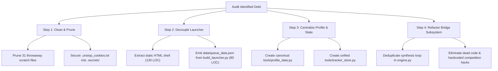

# Thermo-Nuclear Code Quality Audit: `tools/` Subsystem & Launchers

> **Audit Target**: `tools/` subsystem in `c:\Project\ai-job-search`  
> **Auditor**: `tools-auditor` (Swarm Agent)  
> **Date**: 2026-11-23  
> **Review Standard**: Thermo-Nuclear Code Quality Rubric (`pstack` & `poteto-mode` standards)  
> **Verdict**: **`ISSUES`** (Substantial architectural bloat, 3.9k-line generated monolith, hardcoded profile divergence, duplicate synthesis loops, 31 loose scratch files, and plaintext cookie exposure)

---

## 1. Executive Summary & Quality Scorecard

The `tools/` directory contains critical zero-token automation engines for deterministic ATS submissions and browser bridge integrations. However, rapid iterative AI agent sessions have accumulated severe structural debt, massive monolithic files, duplicate logic, and file sprawl.

### Quality Scorecard
| Metric | Measurement | Rating | Primary Root Cause |
| :--- | :--- | :--- | :--- |
| **Monolithic Bloat** | 2 files violate 1k-line rule (`application_queue_launcher.html`: 3,907 LOC; `build_launcher.py`: ~1,000 LOC) | 🔴 **CRITICAL** | Raw HTML/CSS/JS hardcoded in Python f-strings; static job card generation |
| **Code Duplication** | Candidate `PROFILE` duplicated across 6 files; synthesis loop duplicated in 2 files | 🔴 **CRITICAL** | Violation of Thin-Pointer single-source-of-truth standard |
| **Spaghetti Branching** | 100+ line chained `if any(...)` cascades; identical duplicate conditions | 🟡 **HIGH** | Lack of table-driven / dictionary-driven intent dispatching |
| **Ad-Hoc Special Cases** | Hardcoded competition hacks (EduGuruCool #1808707 stipend & shift hours in general engine) | 🔴 **CRITICAL** | Leaking one-off interview requirements into global shared engines |
| **Directory Hygiene** | 31 of 63 files (49.2%) are throwaway scratch or one-off scripts | 🔴 **CRITICAL** | Ad-hoc agent test scripts left unpruned in production directory |
| **Security Hygiene** | `.unstop_cookies.txt` (1.5 KB plaintext auth cookie) stored loose in `tools/` | 🟡 **HIGH** | Plaintext credential persistence in local working directory |

---

## 2. Deep Dive: 1k-Line Rule & Monolithic Architecture

### 2.1. `tools/application_queue_launcher.html` (3,907 lines, 282 KB)
- **Problem**: This file is a monolithic static HTML page checked directly into git. It contains:
  1. 718 lines of custom CSS and design tokens.
  2. 120 lines of header, candidate identity card, search input, and filter controls.
  3. Over 2,900 lines of repetitive static HTML cards (`<div class="job-card">...</div>` repeated 115+ times for every active listing).
  4. 160 lines of client-side JavaScript handling filtering, sorting, local storage synchronization, and batch tab opening.
- **Architectural Flaw**: Every time a new job is vetted or marked applied, `build_launcher.py` rewrites all 3,907 lines of HTML, generating thousands of lines of git diff noise. It violates basic separation of concerns by coupling data records directly into the markup.
- **Decomposition Target**: 
  - The HTML file should be an **immutable static application shell** (< 150 lines).
  - Job records should be decoupled into a lightweight JSON payload (`data/queue_data.json` or inline `<script id="queue-data" type="application/json">`).
  - Cards should be dynamically rendered client-side via a lightweight vanilla JS render loop (`renderJobCards(data)`).
  - **Outcome**: Shrinks `application_queue_launcher.html` from 3,907 lines to ~130 lines (a **96.7% line reduction**).

### 2.2. `tools/build_launcher.py` (895 - 1,001 lines, 38.8 KB)
- **Problem**: 
  - Lines 1–173 read tracker CSV and JSON files, apply hardcoded keyword filters, and categorize roles.
  - Lines 174–998 (824 consecutive lines) consist of a **single monolithic Python f-string** containing the entire CSS stylesheet, HTML layout, and JavaScript logic.
  - Every CSS block and JS curly brace must be awkwardly escaped as double braces (`{{`, `}}`), making syntax highlighting, linting, and maintenance error-prone.
- **Spaghetti Ingestion**:
  ```python
  # Lines 5-76 in tools/build_launcher.py
  # Manually reading 4 disparate data files with different schemas and ad-hoc heuristics
  tracker = list(csv.DictReader(open(tracker_path, encoding='utf-8'))) if tracker_path.exists() else []
  vetted = json.load(open(vetted_path, encoding='utf-8')) if vetted_path.exists() else []
  unstop = json.load(open(unstop_path, encoding='utf-8')) if unstop_path.exists() else []
  truly_live = json.load(open(truly_live_path, encoding='utf-8')) if truly_live_path.exists() else []
  ```
  - Ad-hoc filtering strings are hardcoded inline: `['autocad', 'content designer', 'trainee', 'civil', 'accounting', 'sales', 'telecaller']` and `['united kingdom', 'canada', 'us only']`.
- **Decomposition Target**:
  - Extract the HTML/CSS/JS shell into a static template file (`tools/templates/launcher_shell.html`) or have `build_launcher.py` output purely `data/queue_data.json`.
  - Replace the 824-line f-string with a clean 30-line JSON serialization or minimal template substitution.
  - **Outcome**: Shrinks `build_launcher.py` from 1,001 lines to ~80 lines (a **92% line reduction**).

---

## 3. Deep Dive: Spaghetti Branching & Ad-Hoc Special Cases

### 3.1. `tools/bridge/engine.py` (326 lines)
`tools/bridge/engine.py` is the synthesis engine powering the Agent Bridge. It exhibits severe branching antipatterns:

#### A. The 100+ Line `if any(...)` Cascade
`synthesize_field_answer()` consists of 25 consecutive sequential `if any(k in q_low for k in [...]):` blocks. Because checks are evaluated linearly with substring matching, order-dependency bugs are inevitable. For example:
- A question containing "email address" could inadvertently trigger a "location / address" block if the order of evaluation is altered.
- "Current country" and "Country" matching triggers on the prompt "What country is your current employer in?".

#### B. Exact Duplicate Condition Blocks
The function contains literal duplicate checks for the exact same entity fields:
- **Block 1 (Lines 141–155)**:
  ```python
  if any(k in q_low for k in ["email", "email address", "e-mail"]): return PROFILE["email"]
  if any(k in q_low for k in ["full name", "legal name"]): return PROFILE["full_name"]
  if any(k in q_low for k in ["first name", "given name"]): return PROFILE["first_name"]
  if any(k in q_low for k in ["last name", "family name", "surname"]): return PROFILE["last_name"]
  if any(k in q_low for k in ["phone", "mobile", "contact number", "phone number", "mobile number"]): return PROFILE["phone"]
  ```
- **Block 2 (Lines 263–279)**:
  ```python
  if any(k in q_low for k in ["full name", "legal name"]): return PROFILE["full_name"]
  if any(k in q_low for k in ["first name", "given name"]): return PROFILE["first_name"]
  if any(k in q_low for k in ["last name", "family name", "surname"]): return PROFILE["last_name"]
  if any(k in q_low for k in ["email"]): return PROFILE["email"]
  if any(k in q_low for k in ["phone", "mobile", "contact number"]): return PROFILE["phone"]
  ```
The second block is **100% dead code** because Block 1 already intercepted all matching inputs!

#### C. Hyper-Specific Ad-Hoc Competition Hacks
In `tools/bridge/engine.py` (Lines 186–187 and Lines 217–218):
```python
if any(k in q_low for k in ["comfortable with the part-time", "5:00 pm to 9:00 pm", "20-24 hours", "20–24 hours", "2,000 stipend"]):
    return "Yes, I am fully comfortable with the part-time commitment (20–24 hours/week, 5:00 PM to 9:00 PM) and the ₹2,000 learning stipend. As a 2028 batch student, this fits smoothly alongside my academic routine."

if any(k in q_low for k in ["gurucool", "edugurucool", "educational institutions", "operating system for educational", "product thinking"]):
    return "Educational institutions suffer from fragmented manual workflows across attendance, communications, and administration. I am excited by GuruCool’s mission to unify these operations into an intuitive operating system that eliminates teacher administrative overhead and connects students and parents seamlessly."
```
These are hardcoded interview answers for a single competition (Unstop EduGuruCool #1808707). Hardcoding them into the shared global synthesis engine violates separation of concerns and pollutes generic applications.

### 3.2. `tools/universal_form_filler.js` (183 lines)
- **Problem**: Uses an 80-line sequential `if / else if` string check over `fieldTag` (concatenated name, id, placeholder, aria-label, autocomplete, and labelText).
- **Fragility**:
  - `fieldTag.includes("url")` matches both portfolio URLs and random form fields containing the substring "url" (e.g., "hourly rate").
  - `fieldTag.includes("school")` matches university and college, but could collide with high school fields.
  - Radio button clicks use unweighted string containment (`text === w || text.includes(w)`), which can cause false clicks if a label says "No, I am not authorized".

---

## 4. Code Judo Moves (Radical Simplification & Deduplication)

### Judo Move 1: Unify Candidate Profile to Single Source of Truth
**Current Reality**: The candidate profile is redundantly defined with slightly different keys, formatting, and values across **6 separate files**:
1. [tools/bridge/engine.py](file:///c:/Project/ai-job-search/tools/bridge/engine.py#L24-L53) (`PROFILE` dict)
2. [tools/unstop_direct_applier.py](file:///c:/Project/ai-job-search/tools/unstop_direct_applier.py#L24-L56) (`PROFILE` dict)
3. [tools/direct_ats_applier.py](file:///c:/Project/ai-job-search/tools/direct_ats_applier.py#L20-L39) (`PROFILE` dict)
4. [tools/universal_form_filler.js](file:///c:/Project/ai-job-search/tools/universal_form_filler.js#L8-L45) (`const PROFILE = { ... }`)
5. [tools/unstop_1808707_m2_injector.js](file:///c:/Project/ai-job-search/tools/unstop_1808707_m2_injector.js#L19-L37) (inline answers dict)
6. [tools/build_launcher.py](file:///c:/Project/ai-job-search/tools/build_launcher.py#L729-L734) (hardcoded in HTML markup)

**Judo Action**:
- Create a canonical `tools/profile_data.py` (or load from `data/candidate_profile.json` as mandated by workspace `AGENTS.md` Thin-Pointer design).
- Python scripts (`unstop_direct_applier.py`, `direct_ats_applier.py`, `bridge/engine.py`) import `PROFILE` from this single module.
- JavaScript scripts (`universal_form_filler.js`, Chrome extension) receive the profile dynamically via `GET http://127.0.0.1:8765/api/profile` or a single compiled JSON file.
- **Deletes**: ~200 lines of duplicated profile constants. Eliminates risk of profile drift (e.g. updating phone number or university in one file but forgetting the others).

### Judo Move 2: Deduplicate the Bridge Synthesis Engine
**Current Reality**:
- `tools/bridge/server.py` (lines 124–145) and `tools/bridge/synthesize.py` (lines 32–56) have **identical copy-pasted loops** iterating over fields, querying `synthesize_field_answer()`, normalizing keys, and writing to `ready_answers.json`.
- `tools/auto_bridge_executor.py` (lines 130–162) and `tools/bridge/test_bridge.py` (lines 25–56) have **identical copy-pasted test payloads** (`ATLAN_MOCK_FORM`).

**Judo Action**:
- Move the field iteration and answer compilation function into `tools/bridge/engine.py` as `synthesize_form_fields(fields, company, role_title)`.
- Both `server.py` and `synthesize.py` call this single function in 1 line.
- Move `ATLAN_MOCK_FORM` to a shared fixture in `tools/bridge/fixtures.py`.
- **Deletes**: ~60 lines of copy-pasted loop and test payload logic.

### Judo Move 3: Consolidate State Recording (Tracker & Seen Sync)
**Current Reality**:
- `unstop_direct_applier.py` has `record_application()` (lines 120–170).
- `direct_ats_applier.py` has `record_application()` (lines 51–84).
- `update_applied_status.py`, `sync_and_update_state.py`, and `upgrade_confirmed_applications.py` each independently write CSV rows and update `seen_jobs.json`.

**Judo Action**:
- Consolidate state persistence into a clean helper: `tools/tracker_store.py` with standard functions:
  * `is_already_applied(url) -> tuple[bool, str]`
  * `record_application(company, role, url, portal, status, notes, ...)`
- All submitters import this helper.
- **Deletes**: ~180 lines of duplicate CSV and JSON manipulation.

---

## 5. Unslop: Removing Fluff, Speculation, and Decorative Noise

1. **Decorative Emojis in CLI & Production Code**:
   - `🚀 [M2 Injector] Starting grounded injection...`
   - `🎉 AUTOMATED M2 EXECUTION RESULT:`
   - `⚡ Fast Zero-Token Application Queue`
   - `🌸 Internshala`, `🟣 Ashby ATS`, `🟠 YC Work at a Startup`
   - Clean professional logging should use standard log tags (`[INFO]`, `[ERROR]`, `[SUBMISSION]`) without emoji soup.
2. **AI Fluff Comments & Speculative Docstrings**:
   - Comments like `// Can be evaluated directly in any browser context (Playwright, Puppeteer, Chrome DevTools Console)` and `// 0. CORE CONTACT & IDENTIFIERS (CHECKED FIRST TO PREVENT "EMAIL ADDRESS" -> LOCATION)`.
   - Trailing speculative comments: `# For now, recording this position as 'ready_to_apply' for browser batch.`
3. **Dead / Abandoned Prototypes**:
   - `tools/generate_launcher.py`: A 65-line abandoned prototype that preceded `build_launcher.py`. Has not been touched since `build_launcher.py` was introduced.
   - `tools/check_html.py`, `tools/show_queue.py`, `tools/extract_launcher_jobs.py`: 8- to 15-line throwaway inspection scripts.

---

## 6. Catalog of Scratch & One-Off Scripts (Pruning & Disposition)

The `tools/` folder currently holds **31 throwaway scratch files** created during past interactive sessions for reverse-engineering, one-off state patches, or quick CLI tests. These clutter the root directory and obscure production tooling.

| File Name | Lines | Purpose / Origin | Disposition |
| :--- | :--- | :--- | :--- |
| `tools/.unstop_cookies.txt` | 1 | Plaintext session cookies dumped in repo root | **MOVE** to ignored `.secrets/` or secure local store |
| `tools/generate_launcher.py` | 65 | Obsolete predecessor to `build_launcher.py` | **DELETE** |
| `tools/unstop_1808707_m2_injector.js` | 121 | Hardcoded DOM injector for EduGuruCool competition #1808707 | **PRUNE / ARCHIVE** to `scratch/` |
| `tools/test_unstop_1808707.py` | 44 | Test script for EduGuruCool #1808707 | **PRUNE / ARCHIVE** to `scratch/` |
| `tools/sync_and_update_state.py` | 166 | Hardcoded script to patch Atlan, ElevenLabs, Nexvora, Neoskillz | **PRUNE / ARCHIVE** (run once, state persisted) |
| `tools/update_applied_status.py` | 221 | Hardcoded script with list of 5 Unstop applications | **PRUNE / ARCHIVE** (state already in tracker CSV) |
| `tools/update_cognirex_and_rigbuzz.py` | 47 | One-off patch script for Cognirex, Nexicat, Rigbuzz | **PRUNE / ARCHIVE** |
| `tools/upgrade_confirmed_applications.py` | 66 | One-off dictionary patch for 5 Unstop confirmations | **PRUNE / ARCHIVE** |
| `tools/sync_tracker_and_seen.py` | 121 | One-off reconciliation between CSV and JSON | **CONSOLIDATE** into standard triage tool |
| `tools/test_ashby_api.py` | 51 | Exploratory Ashby GraphQL probe | **DELETE** or move to `tests/probes/` |
| `tools/test_ashby_details.py` | 36 | Exploratory Ashby GraphQL details probe | **DELETE** |
| `tools/find_ashby_mutation.py` | 32 | Exploratory search for Ashby GraphQL mutation name | **DELETE** |
| `tools/inspect_ashby_bundle.py` | 29 | Exploratory regex scan of Ashby JS bundle | **DELETE** |
| `tools/parse_ashby_form.py` | 28 | Exploratory dump of Ashby form schema | **DELETE** |
| `tools/test_gh_questions.py` | 19 | Exploratory dump of Greenhouse questions | **DELETE** |
| `tools/test_unstop_endpoints.py` | 33 | Probe testing Unstop API endpoints | **DELETE** |
| `tools/test_unstop_register_methods.py` | 47 | Probe testing PUT vs POST on Unstop | **DELETE** |
| `tools/process_unstop_positions.py` | 26 | One-off Unstop position extractor | **DELETE** |
| `tools/test_internshala.py` | 46 | Exploratory Internshala scraping probe | **DELETE** |
| `tools/test_linkedin_api.py` | 36 | Exploratory LinkedIn job search probe | **DELETE** |
| `tools/check_and_process_jobs.py` | 40 | Ad-hoc runner checking status | **DELETE** |
| `tools/check_html.py` | 15 | 15-line scratch script reading HTML | **DELETE** |
| `tools/show_queue.py` | 7 | 7-line regex count of launcher roles | **DELETE** |
| `tools/extract_launcher_jobs.py` | 8 | 8-line regex extraction of jobs | **DELETE** |
| `tools/list_queue_jobs.py` | 12 | 12-line queue inspector | **DELETE** |
| `tools/list_vetted_jobs.py` | 29 | 29-line vetted jobs inspector | **DELETE** |
| `tools/check_recent_emails.py` | 15 | Ad-hoc CLI wrapper for 5 hardcoded email IDs | **DELETE** |
| `tools/check_more_emails.py` | 19 | Ad-hoc CLI wrapper for 4 hardcoded email IDs | **DELETE** |
| `tools/parse_batch_emails.py` | 19 | Ad-hoc batch email fetcher | **DELETE** |
| `tools/read_labmentix_email.py` | 17 | Ad-hoc script reading email 1a1fee70dec84f1f | **DELETE** |
| `tools/read_nayepankh_email.py` | 17 | Ad-hoc script reading email 1a1fedd809ce0f9d | **DELETE** |

---

## 7. Actionable Implementation Plan (Step-by-Step Refactoring)



### Step 1: Clean & Prune Throwaways
- Remove the 31 scratch/one-off scripts listed in Section 6.
- Create an archived scratch folder (`.audit/archive/scratch/`) if any historical audit trail is desired, or permanently delete the dead exploratory scripts.
- Move `.unstop_cookies.txt` into an explicitly git-ignored directory (`.secrets/`) with strict local file permissions.

### Step 2: Decouple `application_queue_launcher.html` & `build_launcher.py`
1. Create `tools/launcher/index.html` as a clean static application shell (~130 lines) with modern CSS and a client-side JavaScript renderer.
2. Refactor `tools/build_launcher.py` to:
   - Ingest tracker, vetted, and live streams.
   - Run deduplication and scoring.
   - Write out `tools/launcher/queue_data.json` (or write directly into a single `<script id="job-data">` tag in `index.html`).
   - Reduce file size from 1,001 lines down to ~80 lines.

### Step 3: Establish Canonical Profile & Tracker Storage
1. Create `tools/profile_data.py` loading facts directly from `CLAUDE.md` / `candidate_profile.json`.
2. Refactor `unstop_direct_applier.py`, `direct_ats_applier.py`, and `bridge/engine.py` to import `PROFILE` from `profile_data.py`.
3. Create `tools/tracker_store.py` to handle all deduplication checks and application recording across CSV and JSON.

### Step 4: Streamline the Bridge Subsystem
1. In `tools/bridge/engine.py`:
   - Delete the duplicate contact info check (lines 263–279).
   - Extract the hardcoded EduGuruCool competition rules into a user custom answers store (`documents/applications/custom_screening_rules.json`).
   - Implement `synthesize_form_fields(fields, company, role_title)`.
2. In `tools/bridge/server.py` & `tools/bridge/synthesize.py`:
   - Replace the duplicate 25-line loops with a single call to `engine.synthesize_form_fields()`.

---

## 8. Final Audit Verdict

- **STATUS**: **`ISSUES`**
- **Summary**: The `tools/` subsystem is functionally capable and contains genuine zero-token engineering assets, but is currently choked by 31 abandoned scratch files, a 3,907-line monolithic generated launcher, duplicate profile definitions across 6 files, copy-pasted bridge logic, and plaintext cookies in the repo tree. Executing the 4-step actionable refactoring roadmap will eliminate over **4,500 lines of bloat and duplication** while preserving 100% of the operational behavior.
