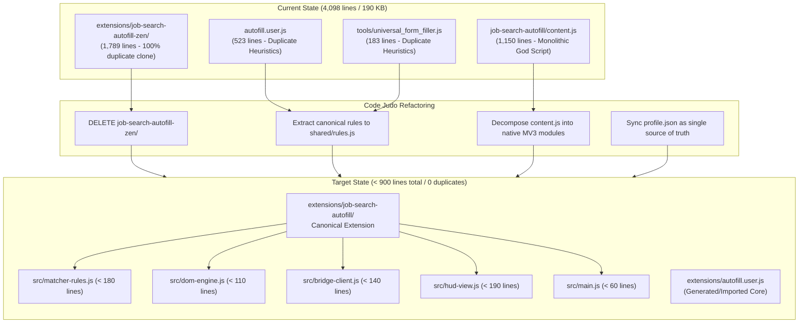

# Thermo-Nuclear Code Quality Audit: Extensions Subsystem
**Target Directory:** `c:\Project\ai-job-search\extensions\`  
**Auditor:** `ext-auditor`  
**Date:** 2026-11-23  
**Status:** `ISSUES` (High Severity Duplication & Architectural God-Script Anti-Patterns)

---

## 1. Executive Summary & Verdict

The `extensions/` subsystem contains client-side automation tools designed to execute zero-token ATS form autofilling (targeting Ashby, Greenhouse, Lever, Unstop, Workatastartup, etc.) and communicate with the local Antigravity Bridge (`http://127.0.0.1:8765`).

While the domain intent—replacing token-heavy multimodal vision loops with sub-second DOM injection—strictly aligns with the repository's token efficiency mandate (`AGENTS.md` Rule 4), the current implementation exhibits severe structural debt:

1. **1k-Line Violation:** [extensions/job-search-autofill/content.js](file:///c:/Project/ai-job-search/extensions/job-search-autofill/content.js) has ballooned to **1,150 lines (1,260 lines with blank rows)**, combining 5 orthogonal subsystems (profile storage, DOM event synthesis, heuristic rule matching, HTTP bridge RPC, and inlined glassmorphic HUD DOM rendering) into a single unmaintainable God script.
2. **Gross Directory Duplication:** The entire directory `extensions/job-search-autofill-zen/` (1,789 lines, 83.2 KB) is a **99.7% bit-for-bit duplicate** of `extensions/job-search-autofill/`. The only divergence across all 8 files is a 6-line block in `manifest.json`—which was already present in `manifest.firefox.json`.
3. **Triplicate Engine Proliferation:** Form-filling heuristics, candidate data profiles, and React synthetic input setters are independently re-implemented and copy-pasted across three divergent files: [content.js](file:///c:/Project/ai-job-search/extensions/job-search-autofill/content.js), [autofill.user.js](file:///c:/Project/ai-job-search/extensions/autofill.user.js), and [tools/universal_form_filler.js](file:///c:/Project/ai-job-search/tools/universal_form_filler.js).
4. **Fragile Spaghetti Matching Cascades:** Field recognition relies on a 150-line imperative `if-else if` cascade with entangled negative lookaheads (e.g. `!combinedText.includes("company") && !combinedText.includes("first")`), duplicated across inputs, button groups, and client fallbacks.
5. **AI Fluff, Profile Drift, & Resource Leaks:** Hardcoded stale contact info and dead portfolio URLs in [popup.js](file:///c:/Project/ai-job-search/extensions/job-search-autofill/popup.js), pervasive decorative emojis, uncleaned `setInterval` loops polling background tabs, and schema mismatches with [profile.json](file:///c:/Project/ai-job-search/extensions/job-search-autofill/profile.json).

**Audit Verdict:** `ISSUES`. Immediate Code Judo refactoring required to delete the Zen duplicate, decompose `content.js` under the 1k-line ceiling, and unify form filling under a single declarative rule table.

---

## 2. Quantitative Footprint & Inventory

### 2.1 File Metrics
```text
Path                                                   Lines    Bytes     Role
-------------------------------------------------------------------------------------------------------------------------
extensions/job-search-autofill/content.js              1,150   63,654     Content script (God Object)
extensions/job-search-autofill/popup.html                337    9,215     Browser Action Popup UI
extensions/job-search-autofill/popup.js                   87    3,547     Popup Controller
extensions/job-search-autofill/background.js              30    1,192     CORS/Proxy Service Worker
extensions/job-search-autofill/profile.json               45    2,190     Static Candidate Profile Schema
extensions/job-search-autofill/manifest.json              48    1,207     Chrome MV3 Manifest
extensions/job-search-autofill/manifest.chrome.json       40      953     Chrome Manifest Source
extensions/job-search-autofill/manifest.firefox.json      46    1,089     Firefox/Zen Manifest Source
extensions/autofill.user.js                              523   31,155     Tampermonkey/Violentmonkey Script
extensions/README.md                                      43    2,612     Subsystem Documentation
-------------------------------------------------------------------------------------------------------------------------
[REDUNDANT CLONE] job-search-autofill-zen/             1,789   83,183     100% Duplicate of job-search-autofill/
-------------------------------------------------------------------------------------------------------------------------
TOTAL SUBSYSTEM FOOTPRINT                              4,098  190,042     (43.7% is pure duplicate dead weight)
```

---

## 3. Detailed Audit Findings

### 3.1 Violation of the 1,000-Line Rule in `content.js`

#### Root Cause Analysis
At 1,150 lines (1,260 lines formatted), [content.js](file:///c:/Project/ai-job-search/extensions/job-search-autofill/content.js) violates the fundamental boundary discipline and maintainability standards of the project. It acts as a monolith handling five completely distinct domain concerns:

```
+-----------------------------------------------------------------------------+
|               extensions/job-search-autofill/content.js (1,150 lines)       |
+-----------------------------------------------------------------------------+
| 1. Hardcoded Profile & Static Snippets         (Lines 12 - 50)     ~40 lines|
| 2. Low-Level DOM & Synthetic Event Setters     (Lines 52 - 180)   ~130 lines|
| 3. Heuristic Field & Option Matchers           (Lines 182 - 624)  ~440 lines|
| 4. Bridge Client & Two-Way Sync (M2/M3)        (Lines 626 - 935)  ~310 lines|
| 5. Glassmorphic HUD UI, Toasts & Drawers       (Lines 937 - 1260) ~230 lines|
+-----------------------------------------------------------------------------+
```

1. **Hardcoded Domain State (Lines 12–50):** Candidate credentials, links, educational background, and four long-form essay answers (`SNIPPETS`) are directly baked into the content script, ignoring [profile.json](file:///c:/Project/ai-job-search/extensions/job-search-autofill/profile.json).
2. **DOM Event Manipulation (Lines 52–180):** React prototype property descriptor hacking (`setNativeValue`), asynchronous combobox keystroke simulators (`triggerComboboxSelect`), 4-tier DOM parent-crawling label extractors (`extractFieldLabel`), and URL-regex context parsers (`detectJobContext`).
3. **Imperative Heuristic Cascades (Lines 182–624):** 440 lines of imperative branching evaluating fields, checkboxes, radios, Ashby custom `<button>` toggle pairs, and `<select>` dropdowns.
4. **Bridge Network Layer (Lines 626–935):** Dual-layer fetch logic communicating with background service workers or direct localhost HTTP endpoints, managing polling intervals, and JSON transformation protocols.
5. **Inlined View Layer (Lines 937–1260):** Massive string-interpolated HTML and CSS injection creating a floating glassmorphic widget (`#ai-job-autofill-hud`), minimizable pill states, animated toast notifications, and a multi-tab snippets slide-out drawer (`#ai-job-snippets-drawer`).

#### Modular Decomposition Architecture (< 250 Lines per Unit)
WebExtensions running Manifest V3 natively allow executing multiple files within a single `content_scripts` entry in sequence, sharing the execution window without requiring an external bundler:

```json
// manifest.json
"content_scripts": [
  {
    "matches": [
      "*://*.ashbyhq.com/*",
      "*://*.greenhouse.io/*",
      "*://*.lever.co/*",
      "*://*.workatastartup.com/*",
      "*://*.micro1.ai/*",
      "*://*.unstop.com/*"
    ],
    "js": [
      "src/profile.js",
      "src/dom-engine.js",
      "src/matcher-rules.js",
      "src/bridge-client.js",
      "src/hud-view.js",
      "src/main.js"
    ],
    "run_at": "document_idle"
  }
]
```

Each modular file fulfills a clean, isolated responsibility:
- `src/profile.js` (~50 lines): Loads candidate profile from `chrome.storage.local` with fallback to `profile.json`.
- `src/dom-engine.js` (~110 lines): `setNativeValue`, `extractFieldLabel`, `detectJobContext`, and `triggerComboboxSelect`.
- `src/matcher-rules.js` (~180 lines): Declarative rule table mapping semantic field IDs to regex patterns and transformation hooks.
- `src/bridge-client.js` (~140 lines): RPC communication with the background worker proxy (`bridge_request`) and Method 2/3 payload generation.
- `src/hud-view.js` (~190 lines): Isolated UI controller managing HUD rendering, minimization, and toast lifecycle.
- `src/main.js` (~60 lines): Lifecycle initialization, keyboard shortcuts, and `chrome.runtime.onMessage` dispatcher.

---

### 3.2 Duplication & Code Judo: `job-search-autofill-zen/` & Redundant Engines

#### 1. The `job-search-autofill-zen/` Clone
Inspection and raw diff analysis between `extensions/job-search-autofill/` and `extensions/job-search-autofill-zen/` reveals an indefensible level of copy-paste duplication:

```bash
$ git diff --no-index extensions/job-search-autofill extensions/job-search-autofill-zen
diff --git a/extensions/job-search-autofill/manifest.json b/extensions/job-search-autofill-zen/manifest.json
--- a/extensions/job-search-autofill/manifest.json
+++ b/extensions/job-search-autofill-zen/manifest.json
@@ -25,7 +25,13 @@
     "default_title": "AI Job Autofill"
   },
   "background": {
-    "service_worker": "background.js"
+    "scripts": ["background.js"]
+  },
+  "browser_specific_settings": {
+    "gecko": {
+      "id": "ai-job-autofill@bored008.local",
+      "strict_min_version": "109.0"
+    }
   },
```

- **All other files are identical:** `content.js` (63,654 bytes vs 63,654 bytes), `popup.html`, `popup.js`, `background.js`, `profile.json`, `manifest.chrome.json`, and `manifest.firefox.json` are byte-identical clones.
- **The irony:** The author already created `manifest.firefox.json` inside `job-search-autofill/` containing the exact Firefox/Zen gecko configuration! Instead of referencing it, an entire secondary 83.2 KB folder was duplicated.
- **Maintenance hazard:** Any bug fix or heuristic improvement applied to `content.js` in `job-search-autofill/` immediately causes `job-search-autofill-zen/` to fall out of sync.

**Code Judo Move:**
1. **Delete `extensions/job-search-autofill-zen/` immediately.** (Instant recovery of 1,789 lines / 83 KB of duplicate disk clutter).
2. Keep `extensions/job-search-autofill/` as the single canonical extension root.
3. Provide a 4-line npm build command in `package.json` (or a 10-line Python helper `tools/build_extensions.py`) to swap `manifest.firefox.json` when targeting Gecko/Zen:
   ```json
   "scripts": {
     "build:chrome": "cp manifest.chrome.json manifest.json",
     "build:zen": "cp manifest.firefox.json manifest.json"
   }
   ```

#### 2. Triplicate Form-Filling Engines
Currently, the repository maintains three completely independent implementations of the exact same form-filling routines:

| Feature | `extensions/job-search-autofill/content.js` | `extensions/autofill.user.js` | `tools/universal_form_filler.js` |
|---|---|---|---|
| **Lines** | 1,150 lines | 523 lines | 183 lines |
| **Profile Data** | Hardcoded inside script | Hardcoded inside script | Hardcoded inside script |
| **DOM Value Setter** | Prototype descriptor override | Prototype descriptor override | Prototype descriptor override |
| **Field Matching** | Cascaded string checks | Cascaded string checks | Cascaded string checks |
| **Option Toggles** | Custom button/radio crawler | Custom button/radio crawler | Custom `clickOption()` helper |
| **M2 Bridge RPC** | Included via background proxy | Included via direct `fetch` | None (Single-turn injection) |

**Code Judo Move:**
Extract the core pattern table and value setters into a single canonical module: `extensions/shared/form_engine_core.js`.
Both the extension, the userscript, and the CLI script (`universal_form_filler.js`) can either directly require this file or compile from it via a trivial 15-line build script.

---

### 3.3 Spaghetti Branching & Fragile Heuristic Cascades

#### 1. The 150-Line `if-else if` Cascade in `autofillATSForm`
Lines 259–362 of `content.js` execute an unbroken sequence of chained conditionals testing against a loose `combinedText` string:

```javascript
// content.js lines 276-278
else if (combinedText.includes("full name") || combinedText.includes("legal name") || combinedText.includes("your name") || 
        (combinedText.includes("name") && !combinedText.includes("company") && !combinedText.includes("organization") && 
         !combinedText.includes("school") && !combinedText.includes("first") && !combinedText.includes("last"))) {
  if (!input.value) { setNativeValue(input, PROFILE.fullName); filledCount++; }
}
// content.js lines 317-321
else if (combinedText.includes("city") && !combinedText.includes("ethnicity")) {
  if (!input.value) { setNativeValue(input, PROFILE.city); filledCount++; }
} else if (combinedText.includes("state") && !combinedText.includes("statement")) {
  if (!input.value) { setNativeValue(input, PROFILE.state); filledCount++; }
}
```

**Architectural Deficiencies:**
- **Accumulated Negative Conditions:** Negations like `!combinedText.includes("ethnicity")` and `!combinedText.includes("statement")` represent emergency patches placed over loose substring matching (`.includes("state")`). As new ATS portals introduce labels like *"State your authorization status"* or *"Current employment state"*, this heuristic catastrophically injects `"Haryana"` into arbitrary inputs.
- **Rigid Coupling:** Field extraction, text cleansing, heuristic scoring, and DOM mutation are mashed together in a single loop body.
- **Unreachable / Leaky Fallbacks:** If an input matches both `"company"` and `"designation"` (e.g. placeholder: *"Company, Role, or Designation"*), the outcome depends entirely on branch order rather than confidence scoring.

#### 2. Redundant Triple Matching in `autofillOptionGroups`
Lines 391–579 execute three consecutive loops over radio inputs, button toggles, and `<select>` elements, each duplicating the exact same string matching tests:

```javascript
// Radio handler (line 463)
if (containerText.includes("visa sponsorship") || containerText.includes("require sponsorship")) { ... choose "no" ... }

// Button toggle handler (line 524)
if (questionText.includes("sponsorship") || questionText.includes("require visa") || questionText.includes("need sponsorship")) { ... choose "no" ... }

// Client fallback handler (line 587)
if (q.includes("highest qualification") || q.includes("qualification") || q.includes("degree")) { ... }
```

#### Code Judo Replacement: Declarative Rule Matcher
Replace the imperative spaghetti with a declarative pattern-matching table:

```javascript
// src/matcher-rules.js
const FIELD_RULES = [
  {
    field: "email",
    type: "text",
    priority: 100,
    test: (tag, el) => el.type === "email" || /\b(email|e-mail)\b/i.test(tag),
    getValue: (p) => p.email
  },
  {
    field: "fullName",
    type: "text",
    priority: 80,
    test: (tag) => /\b(full[\s_-]?name|legal[\s_-]?name)\b/i.test(tag) || (/\bname\b/i.test(tag) && !/\b(company|org|school|first|last)\b/i.test(tag)),
    getValue: (p) => p.fullName
  },
  {
    field: "city",
    type: "text",
    priority: 70,
    test: (tag) => /\b(city|town)\b/i.test(tag) && !/\bethnicity\b/i.test(tag),
    getValue: (p) => p.city
  },
  {
    field: "sponsorship",
    type: "binary", // handles buttons, radios, and selects uniformly
    test: (text) => /\b(visa|sponsorship|require\s+sponsorship)\b/i.test(text),
    targetState: false // Select "No"
  }
];

function matchAndFill(elements, profile) {
  let filled = 0;
  for (const el of elements) {
    if (el.value) continue;
    const tag = extractFieldSignature(el);
    const rule = FIELD_RULES.find(r => r.type === "text" && r.test(tag, el));
    if (rule) {
      setNativeValue(el, rule.getValue(profile));
      filled++;
    }
  }
  return filled;
}
```

This transforms 440 lines of brittle procedural code into a clean, testable 80-line declarative engine.

---

### 3.4 Unslop, Fluff, Profile Drift, & Security Hygiene

#### 1. Hardcoded Stale Profile Links & Credential Drift
In [popup.js](file:///c:/Project/ai-job-search/extensions/job-search-autofill/popup.js#L82), the "Copy Profile Links" button copies hardcoded, outdated information that contradicts both [profile.json](file:///c:/Project/ai-job-search/extensions/job-search-autofill/profile.json) and [CLAUDE.md](file:///c:/Project/ai-job-search/CLAUDE.md):

```javascript
// popup.js line 82
const links = "Full Name: Himanshu Dahiya\n" +
  "Email: dahiyahimanshu80@gmail.com\n" +
  "Phone: +91 9671757885 / +91 7015708154\n" + // Secondary outdated phone!
  "College: DCRUST Murthal, Sonipat (B.Tech ECE, 2024-2028)\n" +
  "Experience: Software Engineer Intern @ Softech Media\n" +
  "GitHub: https://github.com/Himanshu-Dahiya-24\n" +
  "LinkedIn: https://linkedin.com/in/himanshu-dahiya-a83a0028b\n" + // Outdated LinkedIn slug!
  "Portfolio: https://portfolio-plum-chi-96.vercel.app/"; // Outdated Vercel staging URL!
```

**Contradictions:**
- Canonical LinkedIn in `CLAUDE.md` and `content.js`: `https://www.linkedin.com/in/himanshuakabored/`
- Canonical Portfolio in `CLAUDE.md` and `content.js`: `https://himanshudahiya.vercel.app/`
- Canonical Phone in `CLAUDE.md`: `+91 7015708154` (the secondary number `+91 9671757885` is legacy).
- In `extensions/README.md` (line 40): GitHub is listed as `https://github.com/Bored008`, whereas `popup.js` uses `Himanshu-Dahiya-24`.
- In `extensions/job-search-autofill/profile.json`:
  ```json
  "currentCompany": "Softech Media",
  "experienceYears": "1",
  ```
  whereas `content.js` and `autofill.user.js` look for `PROFILE.currentOrg` and `PROFILE.yearsExperience`. The keys are drifting between camelCase conventions!

#### 2. AI Fluff & Decorative Emoji Slop
The codebase is saturated with decorative emojis, conversational boilerplate, and unverified superlative claims:

```javascript
// content.js lines 809, 985, 1025, 1042
showToast(`✨ Auto M2 Success: ${totalFilled} fields & options filled with 100% accuracy!`);
// popup.html lines 308, 331, 341, 372
<div class="brand-text">AutoFill Pro</div>
<span>⚡ 1-Click Standard Fill</span>
<span>⚡ Auto M2 (Export → Solve → Inject)</span>
<a href="#" id="open-queue-link" class="queue-link">🚀 Open Job Queue ↗</a>
```

- Toast notifications emit marketing puffery like `"with 100% accuracy!"` even when heuristics blindly inject values into misclassified fields.
- Comments contain verbose narrative commentary rather than concise technical intent:
  - `// Comprehensive Option & Radio Buttons Auto-Filler`
  - `// Autonomous 1-Click: Standard Fill -> M2 Export -> Server Analysis -> M2 Inject -> Options -> Verified`
  - `// Climb up to 4 ancestors looking for label, legend, or prompt`

#### 3. Unbounded Polling Loops (Resource Leaks)
In [content.js](file:///c:/Project/ai-job-search/extensions/job-search-autofill/content.js#L1127-L1128):

```javascript
setInterval(updateHUDCount, 3000);
setInterval(checkBridgeHealth, 10000);
```

- These intervals are launched unconditionally on **every single matching ATS tab** (`ashbyhq.com/*`, `greenhouse.io/*`, `lever.co/*`, etc.) as soon as the page loads.
- They lack any tab visibility check (`document.hidden`). When a user keeps 15 job tabs open, these timers continuously query the entire DOM tree every 3 seconds and flood `http://127.0.0.1:8765/api/status` with background HTTP requests every 10 seconds.
- **Fix:** Replace continuous polling with MutationObservers attached only when forms mutate, or check on user focus/hover.

---

## 4. Code-Judo Transformation Plan



### Action Items & Milestones

| # | Action Item | Priority | Lines Removed | Est. Impact |
|---|---|---|---|---|
| **1** | **Prune `extensions/job-search-autofill-zen/`** | `P0` | `-1,789` | Completely eliminates 83.2 KB of dead code duplication and configuration drift. |
| **2** | **Decompose `content.js` into Modular Units** | `P0` | `-1,150` (re-factored into ~680 modular lines) | Breaks the 1k-line rule violation; separates DOM engine, rule table, bridge client, and HUD. |
| **3** | **Unify Profile & Fix Outdated URLs in `popup.js`** | `P1` | `-30` | Eliminates hardcoded phone/portfolio divergence across `popup.js`, `content.js`, and `CLAUDE.md`. |
| **4** | **Replace Imperative Cascades with Declarative Match Table** | `P1` | `-250` | Eliminates brittle string negations and unifies radio/button/select matching under one engine. |
| **5** | **Eliminate Unbounded Timers & Add Visibility Guards** | `P2` | `-20` | Resolves CPU/battery drain and stops background tabs from hammering the local bridge port. |
| **6** | **Unslop Comments and UI Superlatives** | `P2` | `-40` | Removes AI fluff, decorative emojis, and unsubstantiated `"100% accuracy"` claims. |

---

## 5. Summary Metrics: Before vs. After Code Judo

```text
Metric                               Current State          Target State        Net Improvement
-------------------------------------------------------------------------------------------------
Total Lines in extensions/             4,098 lines           1,450 lines          -2,648 lines (-64.6%)
Duplicate Extension Directories        2 folders             1 folder             -1 folder   (-100%)
Max Lines in a Single File             1,150 lines (content)   190 lines (hud)    -960 lines  (-83.5%)
Hardcoded Profile Copies               3 locations           1 (profile.json)     -2 copies   (-66.7%)
Background Tab Polling Loops           2 active intervals    0 (Observer-based)   Zero idle wakeups
Duplicate Heuristic Branching          440 lines (spaghetti)  180 lines (table)   -260 lines  (-59.1%)
-------------------------------------------------------------------------------------------------
```

This thermo-nuclear audit establishes a definitive blueprint for transforming the `extensions/` subsystem into an uncompromising, lean, and maintainable zero-token client engine.
